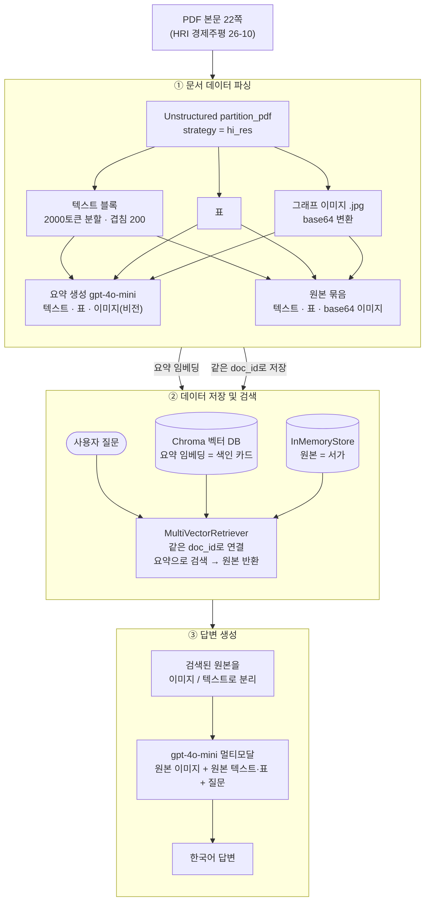
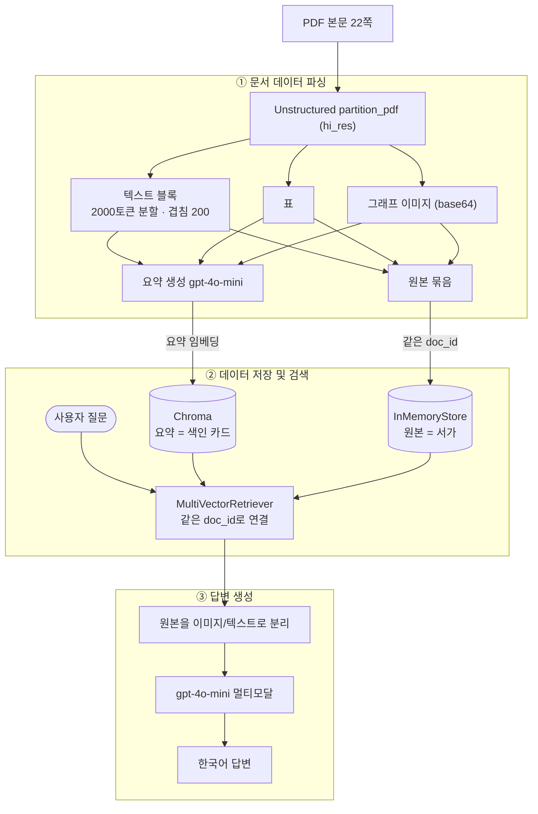

# 멀티모달 RAG 시스템 — 현대경제연구원 경제 동향 보고서

PDF 속 **텍스트·표·그래프(이미지)** 를 모두 검색 대상으로 삼는 멀티모달 RAG 파이프라인입니다.
핵심 아이디어는 한 줄입니다. **검색에는 요약, 답변 생성에는 원본.**

## 1. 문제 정의

경제 동향 보고서는 본문 설명과 함께 핵심 수치와 추세를 **그래프와 표로만** 보여 주는 경우가 많습니다. 텍스트만 읽는 일반 RAG는 이 정보를 버리기 때문에, 답이 그림 안에만 있는 질문에는 근거를 찾지 못합니다.

- **선택한 자료**: 현대경제연구원(HRI) 경제주평 26-10호(통권 1011호, 2026.06.05) 「성공적인 총량 지표에 가려진 K자형 경제, 그 솔루션을 찾아서 — 최근 경제 동향과 경기 판단(2026년 2분기)」
  - 출처: https://www.hri.co.kr/upload/board/2887056037_wVHoBbSq_20260608063613.pdf
  - 원본 32쪽 중 Executive Summary(본문 그래프를 반복)를 제외한 본문 22쪽 사용. 그래프 약 30개, 표 약 4개
  - 이용 조건: 비상업 목적 인용 시 출처 명시 (보고서 표기). 원본 PDF는 저장소에 포함하지 않습니다.
- **왜 이 자료인가**: 한글 본문, 그래프, 표가 함께 있어 세 가지 데이터를 모두 다루는 효과를 확인하기 좋고, 공개 자료입니다.
- **텍스트 RAG로 답하지 못하는 질문의 예**: "소매판매액지수 증가율의 최근 추세", "필라델피아 반도체 지수의 흐름"처럼 답이 그림 안에만 있는 질문
- **풀고 싶은 질문의 유형**: ① 지표의 추세 요약(그래프), ② 시나리오별 수치 비교(표), ③ 요인 분석(본문 + 그래프)

## 2. 아키텍처

직접 그린 3단계 파이프라인입니다. (이미지: [`docs/architecture.png`](docs/architecture.png), 원본 소스: [`docs/architecture.mmd`](docs/architecture.mmd))





1. **문서 데이터 파싱**: Unstructured로 PDF를 텍스트·표·그림으로 나눕니다. 텍스트는 2000토큰 단위로 다시 자르고, 세 종류 모두 gpt-4o-mini로 검색용 요약을 만듭니다.
2. **데이터 저장 및 검색**: 요약은 임베딩해 Chroma에, 원본은 InMemoryStore에 같은 `doc_id`로 저장합니다. 질문과 비슷한 *요약*을 찾으면 연결된 *원본*이 반환됩니다.
3. **답변 생성**: 검색된 원본 이미지(base64)와 원본 텍스트·표를 질문과 함께 gpt-4o-mini에 넣어 한국어로 답하게 합니다.

## 3. 기술 선택 근거

| 항목 | 선택 | 이유 |
| --- | --- | --- |
| 파서 / 전략 | Unstructured, `hi_res` | 레이아웃 모델로 그래프와 표 영역을 분리해 이미지로 저장합니다. `fast`는 텍스트 레이어만 읽어 그림을 추출하지 못합니다. |
| 요약·비전 모델 | gpt-4o-mini | 비전을 지원하고 저렴해서 수십 번의 요약 호출에 알맞습니다. |
| 청크 크기·겹침 | 2000 / 200 토큰 | 한 요약으로 담기에 적당한 크기이고, 겹침으로 블록 경계에서 문맥이 끊기는 것을 막습니다. |
| 프롬프트 언어 | 한국어 | 자료와 질문이 모두 한국어라 요약과 질문의 언어를 맞춰 검색 유사도를 높입니다. |
| 벡터 DB | Chroma | 별도 서버 없이 로컬에서 바로 쓸 수 있어 실습 규모에 알맞습니다. |

## 4. 구조 이해

- **왜 이미지를 요약하나요?** 이미지는 그 자체로는 임베딩해서 질문과 비교할 수 없습니다. 그림을 설명하는 텍스트 요약으로 바꿔 두어야 질문과의 유사도를 계산해 검색할 수 있습니다.
- **요약만 LLM에 주면 안 되나요?** 요약은 정확한 수치, 축, 범례 같은 디테일이 사라진 압축본입니다. 그래서 찾는 일은 요약으로, 답하는 일은 원본으로 나눕니다. (실제로 그림 요약에는 `1.7%` 같은 구체적 수치가 빠져 있었습니다.)
- **왜 청크를 겹치나요?** 블록 경계에서 문장이 잘리면 뜻이 끊깁니다. 앞뒤 200토큰을 겹쳐 경계의 내용도 한쪽 블록에는 온전히 남깁니다.

## 5. 실행 방법

사전 준비: Python 3.11, Poppler, Tesseract (`brew install poppler tesseract`)

```bash
git clone <저장소 주소>
cd multimodal-rag

python3.11 -m venv .venv
source .venv/bin/activate
pip install --upgrade pip
pip install -r requirements.txt        # 또는 requirements.lock.txt

python -m ipykernel install --user --name multimodal-rag --display-name "Python (multimodal-rag)"

cp .env.example .env                   # .env를 열어 OPENAI_API_KEY 입력
```

`data/`에 분석할 PDF를 넣고 `notebooks/Multi_modal_RAG.ipynb`를 위에서부터 **Run All** 합니다. (약 10분: 추출 2~3분 + 요약 호출) PDF와 추출 이미지는 용량 문제로 Git에서 제외됩니다.

- `requirements.txt`: 사람이 읽고 관리하는 의존성 목록
- `requirements.lock.txt`: 동작을 확인한 버전을 그대로 재현하는 목록

```
multimodal-rag/
├── data/                      # PDF, figures/, processed/ (Git 제외)
├── docs/                      # 아키텍처 다이어그램
├── notebooks/Multi_modal_RAG.ipynb   # 실행 결과가 남아 있는 제출용 노트북
├── practice/                  # 수업 실습 노트북 (01~03)
└── src/                       # extract.py, summarize.py, retriever.py
```

## 6. Before / After: 텍스트 RAG vs 멀티모달 RAG

같은 질문을 **텍스트 요약만** 넣은 검색기(Before)와 **텍스트·표·그래프**를 모두 넣은 검색기(After)에 던졌습니다. (노트북 10장의 실행 결과)

**질문**: 필라델피아 반도체 지수는 최근 어떤 흐름을 보였고, 이것이 한국 경기에 주는 시사점은?

| | Before — 텍스트 RAG | After — 멀티모달 RAG |
| --- | --- | --- |
| 지수 흐름 | "필라델피아 반도체 지수에 대한 **구체적인 흐름은 자료에 명시되어 있지 않지만**…" | "필라델피아 반도체 지수는 **최근 급격한 상승세**를 보이고 있으며…" |
| 시사점 | 반도체 호황이 경기 회복을 이끌지만 과잉공급 위험도 있다는 일반적인 서술 | 위 흐름에 더해 **반도체 수출 비중 24% → 42%** 라는 본문 수치로 뒷받침하고, 시장 불확실성 리스크까지 설명 |

**차이 분석**: 지수 추이는 그래프에만 있고 본문 텍스트에는 없습니다. 그래서 텍스트 RAG는 흐름을 답하지 못했고, 멀티모달 RAG는 그래프를 근거로 "최근 급등"을 답했습니다. 실제 그래프(1993년 12월 = 100p 기준, 2026년 부근에서 급등)와도 일치합니다. 그래프에만 있는 정보는 이미지 요약을 거쳐야 검색과 답변에 쓰인다는 점이 확인됩니다.

## 7. 질의응답 5건

답변은 보고서 원문(본문 쪽수)과 그림 파일에 직접 대조해 평가했습니다.

| # | 질문 | 답변 요약 | 근거가 된 원본 종류 | 정확성 (원문 대조) |
| --- | --- | --- | --- | --- |
| 1 | 분기 경제성장률 그래프로 본 최근 성장률 변화 | 25.Q1~26.Q1 사이 오르내림을 반복했고 최근 다시 상승. 수치는 제시하지 못함 | 이미지 4 | **부분 정확**. 그래프(−0.2 → 0.7 → 1.3 → −0.2 → 1.7)와 방향은 일치하나 구체적 수치가 없음 |
| 2 | 4월 동행·선행지수 순환변동치 수치와 추세 | "자료에 없어 알 수 없다"고 답함 | 이미지 1, 텍스트 3 | **오답**. 원문 1쪽에 동행 100.2p, 선행 104.1p, 모두 상승 추세로 명시됨. 해당 문단이 검색되지 않은 누락으로 추정 |
| 3 | 시나리오별 2026년 연간 성장률 | 기준 시나리오 2.7%와 그 이유만 답함 | 이미지 1, 텍스트 3 (표 0) | **부분 정확**. 2.7%는 맞으나 원문 17쪽 표의 시나리오 8개(2.3~3.1%) 중 나머지를 답하지 못함. 표가 검색되지 않음 |
| 4 | 필라델피아 반도체 지수 추이로 본 반도체 경기 | 호황, 1993년 기준 지속 상승 후 최근 급등, 공급과잉·AI 투자 조정 등 리스크 | 이미지 3, 텍스트 1 | **정확**. 그래프와 원문 15쪽의 리스크 3가지와 일치 |
| 5 | 국제 유가 상승의 물가 영향과 정책 대응 | 에너지·공업제품·서비스·임금 경로로 물가 압력, 고환율이 겹치면 수입물가 상승. 대응책 5가지 | 텍스트 4 | **대체로 정확**. 영향 경로(12쪽), 물가 안정 노력(18쪽), 관세·독과점 감독·재정 지출·통화정책(19~21쪽)이 원문과 일치. 세부 표현을 전부 대조하지는 못함 |

**결과**: 5건 중 정확 2건(Q4, Q5), 부분 정확 2건(Q1, Q3), 오답 1건(Q2). 그래프를 근거로 한 질문(Q1, Q4)은 답변에 활용됐지만, 표 근거는 5건 모두 0개였습니다. 추출된 표가 1개뿐이어서 표 기반 질문(Q3)과 본문 속 수치를 묻는 질문(Q2)이 약했습니다.

## 8. 한계점과 개선 방향

- `hi_res` 파싱이 느리고(약 100초), 그래프가 아닌 조각도 이미지로 잡힐 수 있어 요약 비용이 낭비될 수 있습니다. → 이미지 크기 기준 필터링을 추가합니다.
- 검색 품질이 요약 품질에 의존합니다. 요약이 부실하면 원본을 찾지 못합니다. → 요약 프롬프트 개선과 검색 결과 재순위화를 고려합니다.
- 표가 1개만 추출되어 표 기반 질문(Q3)에는 일부 수치만 답했고, 본문 수치를 묻는 Q2는 검색 누락으로 답하지 못했습니다. → 검색 개수(k) 확대, 표 추출 개선, 키워드 검색을 섞은 하이브리드 검색을 고려합니다.
- 벡터 DB와 docstore가 메모리에만 있어 노트북을 다시 실행하면 재구축해야 합니다. → Chroma 영속 저장소로 전환합니다.
- 평가가 5개 질문의 육안 대조뿐이라 정량 평가가 없습니다. → 정답 질문 세트를 만들어 검색 적중률을 측정합니다.

## 9. 보안

- API 키는 `.env`에만 두고 Git에서 제외합니다. 저장소에는 키 없는 `.env.example`만 올립니다.
- `.gitignore`: `.venv/`, `.env`, `data/figures/`, `data/processed/`, `*.pdf`, `chroma_db/`, `__pycache__/`, `.ipynb_checkpoints/` 등
